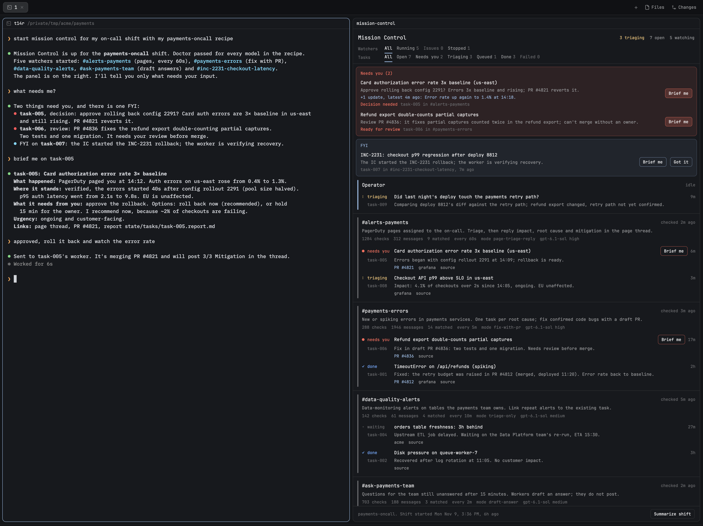

# oncall-mc: Mission Control for an on-call shift

A Herdr space for on-call. It works with any layout and leaves your other spaces alone.
The space has two panes:
- An **operator** agent that you talk to.
- A **panel** that lists every Slack **watcher** with its stats, and the triage **worker** tasks under each watcher:
  status, summary, PRs and links. Filter by watcher or task status. Click any row to open its live terminal.



*A mock shift (made-up data). Left: the operator, briefing the on-call on a page and taking their decision.
Right: the panel. Two tasks need input (a rollback decision and a PR review), one FYI waits for "Got it", and
five watchers sit below with their tasks, PRs and stats.*

## Get started with one prompt

Paste this into any coding agent running in Herdr:

```text
Install oncall-mc from https://github.com/junyu-w/oncall-mc: clone it to ~/.local/share/oncall-mc, run ~/.local/share/oncall-mc/bin/oncall-mc install, read `oncall-mc guide`, then show me a short summary of how to prompt you to use it.
```

The agent installs the panel, the CLI and an `oncall-mission-control` skill, then replies with prompts
you can use. After that, prompts like these work in any agent session:

- "Start oncall mission control for my shift." Add "with my `<name>` recipe", or paste a recipe.
- "Watch #alerts for pages assigned to me; triage them and reply in the thread."
- "Resume mission control." Use this after a restart.
- "What is mission control doing?"
- "End my shift."

Everything is packaged in one CLI, `bin/oncall-mc`, which carries its own agent manual (`oncall-mc guide`).

## Install

Needs:
- [Herdr](https://herdr.dev), with the app running and `hc` / `herdr-app` on PATH
- macOS or Linux
- Python 3.8+ (3.11+ for TOML recipes)
- `git`
- Agent CLIs that have Slack access (MCP or app connectors). The defaults are `claude` for the operator and
  `codex` for watchers and workers.

**With an agent:** use the one-line prompt above. To install and start straight away, append "…then set up
oncall mission control for my shift with this recipe: …" to it. The agent then follows `oncall-mc guide`:
1. It asks you for the agent flags.
2. It runs `oncall-mc doctor`.
3. It saves your recipe.
4. It starts the shift.

**By hand:**

```sh
git clone https://github.com/junyu-w/oncall-mc ~/.local/share/oncall-mc
~/.local/share/oncall-mc/bin/oncall-mc install    # panel + agent skill + ~/.local/bin/oncall-mc + state/config.json
$EDITOR ~/.local/share/oncall-mc/state/config.json # agent commands, with the flags that stop approval prompts
oncall-mc doctor                                   # starts a throwaway agent per command; checks no prompts, state writes, hc, Slack
cd <repo> && oncall-mc start --recipe <name>
```

`start` refuses until `doctor` passes for the current agent commands. This is the most common failure: an
unattended watcher that stops at an approval prompt, or that a sandbox stops from writing to `state/`.

Update later with `oncall-mc update`. It runs `git pull` and reinstalls the panel, and running agents keep going.
Uninstall in three steps:
1. `oncall-mc end --yes`
2. Delete the checkout and `~/.local/bin/oncall-mc`.
3. Delete `~/.config/herdr-app/mods/mission-control` and the `oncall-mission-control` links in your agent skills
   folders.

## Commands

| Command | What it does |
|---|---|
| `oncall-mc guide` | The manual for agents. Read it first. |
| `oncall-mc update` | Pulls the latest version and reinstalls the panel |
| `oncall-mc doctor [--restart]` | Preflight: proves the configured agents can run unattended, write state, reach hc, and read Slack |
| `oncall-mc install` | Checks prerequisites, installs or updates the Herdr panel, puts the CLI on PATH, creates the config. |
| `oncall-mc start [--recipe] [--name] [--workdir] [--replace]` | Starts a new shift session, optionally from a recipe. The previous session is archived. |
| `oncall-mc recipe ls\|add\|show\|check\|apply <name>` | Lists, saves (from pasted text), shows, validates, or applies recipes |
| `oncall-mc modes` | Lists the worker modes in this session |
| `oncall-mc resume [--panel]` | Restarts whatever died (operator, watchers, tickers, triaging workers) and keeps what is alive. Then re-shows the space. |
| `oncall-mc status [--json]` | Shows the session, the agents (dead ones flagged) and open tasks. |
| `oncall-mc end [--yes]` | Stops every agent of the session, archives it and closes the space. |
| `oncall-mc tell '<msg>'` | Sends a message to the operator. |
| `oncall-mc summary [--since]` | End-of-shift summary of every task, written by the operator to `state/summaries/` (the panel's "Summarize shift" button). A recipe's `[summary] prompt` sets the format. |
| `oncall-mc brief <task>` | Asks the operator to catch you up on a task: what happened, where it stands, what it needs from you (also the panel's "Brief me" button) |
| `oncall-mc watcher restart <id> [--from-now]` | Brings a stopped watcher back with its stats and saved Slack position; `--from-now` skips the backlog |
| `oncall-mc watcher set <id> --interval N` | Changes a running watcher's interval. Applies within seconds. |
| `oncall-mc task reassign <id> --to <watcher-id\|operator>` | Moves a task to another owner. The worker, the new owner and the old owner are told. |

The operator, watchers and workers use the rest themselves:
- `watcher new|show|stat|stop|remove|ls`
- `task new|update|dispatch|reassign|show|ls`
- `escalate --need review|decision` (the user's input is needed), `notify` (an FYI that keeps the status and stays in the FYI strip until acked), `ack [--fyi]`
- `tick` (internal)

## Recipes

A recipe bootstraps a shift in one command: `oncall-mc start --recipe my-oncall`. It is a TOML file (Python 3.11+)
or a JSON file. It defines:
- **Worker modes.** Each mode is a named prompt that says what workers may do, for example `triage-only`,
  `triage-reply` or `fix-with-pr`. Modes are prompts you write, not fixed settings. oncall-mc attaches a
  watcher's mode to every worker brief word for word, so watchers can't drop or loosen it. Direct tasks can
  pick a mode too.
- **Standing instructions** for the operator.
- **Watchers.** Each watcher has a channel, channel ID, interval, lookback, mode, what counts as interesting,
  and when to escalate.

Recipes can also set models and reasoning effort:
- **Per role:** `[agents.operator|watcher|worker]` with `model` and `effort`.
- **Per mode:** for that mode's workers.
- **Per watcher:** `model`/`effort`, and `worker_model`/`worker_effort`.

oncall-mc swaps them into the agent commands with each CLI's own flags: Codex and Claude are built in, and
others can be added under `agent_flags` in `config.json`. `oncall-mc doctor --recipe <name>` probes every
combination before `start --recipe` runs.

Start from [`recipes/example.toml`](recipes/example.toml):

```sh
mkdir -p ~/.config/oncall-mc/recipes
cp recipes/example.toml ~/.config/oncall-mc/recipes/my-oncall.toml   # edit channels, modes, intervals
oncall-mc recipe check my-oncall
oncall-mc start --recipe my-oncall
```

Keep personal recipes in `~/.config/oncall-mc/recipes/`. They hold channel IDs and paths, so they don't belong in
shared repos.

(`RECIPE.md` in this repo is something else: it is Herdr's build brief for the panel mod.)

## Configure

`state/config.json`:

```json
{
  "workdir": "/path/to/repo",
  "operator_cmd": ["claude"],
  "watcher_cmd": ["codex"],
  "worker_cmd": ["codex"],
  "max_active_workers": 3
}
```

Each command gets the agent's first message as its last argument.

Change behavior by editing the role briefs in `prompts/`:
- `OPERATOR.md`
- `WATCHER.md`
- `WORKER.md`

## How it works

- `oncall-mc` is the only thing that starts agents or writes state. Agents run as `hc` terminals:
  - Watchers are children of the operator.
  - Workers are children of their watcher.
  - Reports go up the tree with `hc send`.
- A ticker terminal wakes each watcher every interval, but only while the watcher is idle.
- `state/board.json` feeds the panel. Each session's `watchers/`, `tasks/` and reports are archived to
  `state/archive/<session>/` on `start` or `end`.
- Watchers keep their Slack cursor in state. A watcher restarted by `resume` continues where it stopped.
- Agents keep running when the Herdr window closes, but stop when the machine sleeps or restarts.
  After a restart, run `oncall-mc resume`.
- Every watcher check is a model call. Use longer intervals for quiet channels.

## License

MIT. See [LICENSE](LICENSE).
