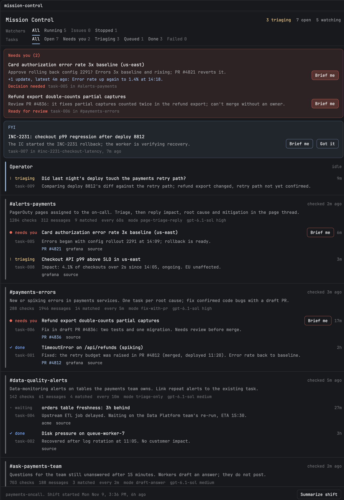

# Mission Control

> **This panel needs the `oncall-mc` CLI from this repo.** The panel only shows what the CLI writes. On its own
> it reads "No session yet". Install both with one command:
> `git clone https://github.com/junyu-w/oncall-mc ~/.local/share/oncall-mc && ~/.local/share/oncall-mc/bin/oncall-mc install`
> (it installs this panel, links `oncall-mc` into `~/.local/bin`, and adds an agent skill). Then tell any agent:
> "read `oncall-mc guide` and start oncall mission control for my shift".
>
> **What it runs:**
> - **Programs:** the panel calls `exec` to run `<repo>/bin/oncall-mc` (for Brief me, Got it and Summarize shift)
>   and to open links with `open`, `xdg-open` or `start`.
> - **Files:** it reads files outside its own folder: `<repo>/state/board.json`.
> - **Network:** none from the panel itself. The agents use their own Slack tools.

Mission Control runs an on-call shift in a Herdr space called "Mission Control". The left pane is the operator,
an agent you talk to. The right pane is this panel. It shows what needs your input, FYIs waiting for a "Got it",
the operator's own tasks, and every Slack watcher with the triage tasks it started. Click any row to open that
agent's live terminal.

## What you see

A single mod pane, top to bottom. Text uses the theme's UI font; sizes are px at zoom 1 (names 13.5,
body 12.5, metadata 11.5). Every color is a theme color, so the panel follows the person's theme.

1. **Header**, 14px side padding. "Mission Control" in 15px semibold on the left. On the right, in 11.5px:
   `N triaging` in `working` (only when N > 0), `N open` and `N watching` in `muted`. Items are vertically centered.
2. **Filter tabs**: two rows of text tabs under a 1px `border` line.
   - Watchers: All, Running, Issues, Stopped.
   - Tasks: All, Open, Needs you, Triaging, Queued, Done, Failed.
   Each tab except All shows its count. The selected tab has a 2px `accent` underline; tabs with 0 are `dim`.
3. **Needs you strip**: shown only when a task has status `needs-you` or a watcher is flagged. Background `blocked`
   at ~10% alpha (`1a`), border at ~33% (`55`), 8px radius. Header "Needs you" or "Needs you (N)" in `blocked`.
   Each item, left to right:
   - Text: the title (12.5 medium); the request (12, `muted`); optionally "+N updates, latest Xm ago: …" in
     `accent` (FYIs that arrived while it needed you); then a kind label in `blocked` ("Decision needed",
     "Ready for review" or "Needs your input") and `task-NNN in #channel` in `dim`.
   - Button: **Brief me**, on the right.
4. **FYI strip**: shown when tasks have unacknowledged FYIs and do not need the person. Background `accent` at
   ~8% (`14`), border at ~27% (`44`), 8px radius. Header "FYI" or "FYI (N)" in `accent`. Each item: the title,
   the latest FYI, then `task-NNN in #channel, Xm ago, N FYIs` in `dim`. Two buttons on the right:
   **Brief me** and **Got it**.
5. **Operator row** (always first, whatever the filter): "Operator" with its state on the right ("working" with
   a spinner, "idle", "replied", "needs you" or "not running"), then its direct tasks.
6. **Watcher rows**: each row has a 3px status rail down its left edge and a 1px `border` line under it.
   - Line 1: the channel (13.5 medium) and `checked Xs ago` on the right.
   - Line 2: one `muted` line of the goal.
   - Line 3: `dim` stats spaced 12px apart: checks, messages, matched, `every 60s`, `mode <name>`, and
     `<model> <effort>` when set.
   - Warnings in `blocked` when there is a problem: an error, "No check-in for a while…", "Watcher has exited…".
   - One `working`-colored line, "Watchdog restarted a hung turn … (stuck N min)", for 24h after the watchdog acted.
7. **Task rows** under each watcher:
   - An 82px status column: glyph and word on line 1 (◦ queued, braille spinner triaging, ◦ waiting, ● needs you,
     ✓ done, ✕ failed), and the task id (`task-012`) on line 2.
   - The title (12.5) with its age on the right. A needs-you task also gets a **Brief me** button. A task whose
     worker is busy but whose status says otherwise shows an amber spinner and "worker active".
   - Line 2: the summary, `muted`.
   - Optional lines: "FYI Xm ago: …" in `accent` until acknowledged; "Worker is waiting for an approval…" in
     `blocked`; PR and link labels as plain text (PRs in `accent`, others in `muted`, underlined on hover).
8. **Stopped watchers** fold into one `dim` line ("N stopped watchers"). Click it to expand them.
9. **Footer**, pinned under the list with a 1px top border: "<session name>. Shift started Wed Nov 4, 10:30 PM,
   2d ago" in `dim` on the left, and a **Summarize shift** button on the right.

## How it behaves

- **Status rails:** `working` when the watcher's agent is working, `blocked` for issues (exited, blocked, error,
  flagged, or no check-in for max(3 × interval, 10 min)), `border` when stopped, `idle` otherwise.
- **Status shown:** a `waiting` or `queued` task whose worker is working shows as triaging. The filters and counts
  follow the shown status. Spinners use `.frames(SPIN, 90)`; no timer drives them.
- **Clicks:**
  - A watcher, task, strip item or operator row runs `terminal.peek` on that agent. A dead agent gives a toast
    saying to run `oncall-mc resume`.
  - **Brief me** runs `oncall-mc brief <id>`, then `pane.focus` on the operator. The button reads "Briefing in
    operator" for 60s.
  - **Got it** runs `oncall-mc ack <id> --fyi` (clears only FYIs).
  - **Summarize shift** runs `oncall-mc summary`, then focuses the operator. It reads "Summary in operator" for 120s.
  - PR and link labels open the URL with the platform opener. They stop the click from reaching the row.
- **Folding:** finished tasks older than 24h, or beyond the newest 3, fold behind "Show N older". A task filter
  shows every match.
- **Toasts:** a newly flagged task (status `needs-you`) posts a warning toast. Clicking it peeks the agent.
  FYIs post no toast.
- **Memory:** the selected filters persist per mod copy (`localStorage`).
- **Refresh:** the panel redraws when `<state>/board.json` changes (`watchFolder`), and every 30s for relative
  times.

## Built from

- **This mod:** `mods/mission-control/main.js`, one View class. Props: `{ state: <absolute state folder> }`.
  - Reads `<state>/board.json` (`{ operator, session, watchers[], tasks[] }`).
  - Live status from `agents()` and `terminals()`.
  - Calls `run("terminal.peek")`, `run("pane.focus")`, `notify`, `exec`, `watchFolder`, `readTextFile`,
    `theme`, `props` and `window`.
- **The CLI:** `bin/oncall-mc`, Python 3, standard library only.
  - It is the only writer of state and the only launcher of agents, as `hc` terminals.
  - It creates the space by labelling the operator terminal `herdr.space` / `herdr.tab`, then runs
    `space.rename` and `pane.split {mod: "mission-control", props: {state}}`.
  - It runs one ticker terminal per watcher. The ticker wakes the watcher while it is idle, and its watchdog
    interrupts a turn that hangs.
- **Role briefs:** `prompts/OPERATOR.md`, `WATCHER.md` and `WORKER.md`.
- **Shift recipes:** `recipes/*.toml` (modes as prompts, models and effort, watchers, summary format). These are
  separate from this file.
- **Agent skill:** `skills/oncall-mission-control/SKILL.md`.

## Watch out

- The panel is only a view: every button calls the CLI. Without `oncall-mc` installed, it shows "No session yet".
- Watchers and workers run unattended. Agent commands that stop at approval prompts hang them. `oncall-mc doctor`
  checks this before a shift, and `start` refuses until it passes.
- Every watcher cycle is a model call. Quiet channels should get longer intervals.
- Agents survive a closed window, but not sleep or a reboot. After either, run `oncall-mc resume`.
- `hc` terminal names are global. The CLI adds a suffix (`task-001-2`) when a name is taken.
- Herdr's JavaScript runtime ignores `toLocaleString` options, so dates are formatted by hand.
- Requires macOS or Linux, because the CLI uses `fcntl` locks.

## Done when

- `oncall-mc install` reports the panel installed with `check passed`.
- `oncall-mc start` opens a "Mission Control" space: the operator on the left, this panel on the right, with the
  footer showing the shift start.
- Asking the operator for a watcher adds a watcher row within a minute, and its "checked … ago" stays fresh.
- `oncall-mc escalate <task> --need decision '…'` puts the task in the red strip, labelled "Decision needed".
  **Brief me** focuses the operator, which briefs you.
- `oncall-mc notify <task> '…'` on a triaging task puts it in the FYI strip. **Got it** removes it.
- Clicking a task row opens that worker's terminal.
- **Summarize shift** makes the operator write a summary under `state/summaries/`.
